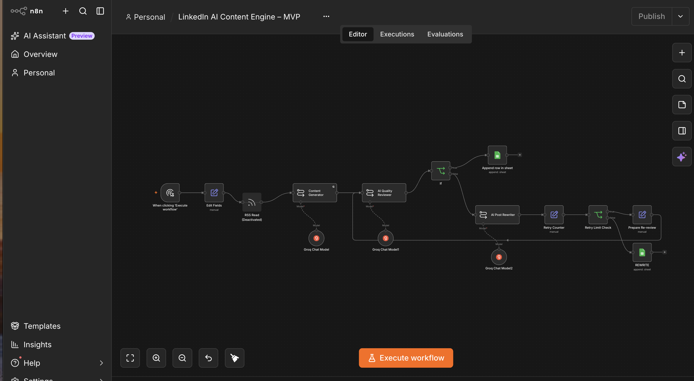
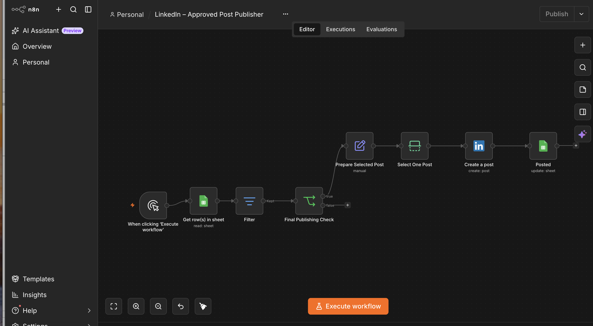

# 🤖 AI-Powered LinkedIn Content Automation Engine

**An AI-assisted content generation, quality review and LinkedIn publishing system built using n8n.**

This project is my first practical implementation exploring how AI and workflow automation can simplify professional content creation.

## 🚀 Project Overview

Creating consistent LinkedIn content takes time. I wanted to explore how AI could support the complete content workflow while keeping humans in control.

## 📸 Actual n8n Workflow Implementation

### Workflow 1 — AI Content Generation and Quality Review

This workflow generates LinkedIn content, evaluates quality, handles rewriting and sends accepted content to Google Sheets for human approval.

### Workflow 2 — Approved LinkedIn Post Publisher

This workflow retrieves approved content, validates publishing eligibility, publishes one post to LinkedIn and updates the publishing status in Google Sheets.

With this project, I built two n8n workflows.

## ⚙️ Workflow 1 — AI Content Generation

- Generate LinkedIn content using Groq AI.
- Review generated content using an AI Quality Reviewer.
- Evaluate content through a conditional decision.
- Rewrite content when it requires improvement.
- Apply retry handling with a retry limit.
- Store accepted content in Google Sheets for manual approval.

## 🔗 Workflow 2 — LinkedIn Publishing

- Retrieve approved posts from Google Sheets.
- Filter posts that haven't been published.
- Validate publishing eligibility.
- Select one post per execution.
- Publish to my personal LinkedIn profile.
- Update Google Sheets with POSTED status and the LinkedIn post URL.

## 🛠️ Tech Stack

| Technology | Purpose |
|---|---|
| n8n Community Edition | Workflow automation |
| Groq AI | Content generation and review |
| Google Sheets | Content queue and approval |
| LinkedIn API | LinkedIn publishing |

## 💡 Key Engineering Concepts

- AI workflow orchestration
- Prompt engineering
- AI output validation
- Human-in-the-loop approval
- Conditional workflow execution
- Retry and failure handling
- API integration
- Workflow status tracking

## 📸 Workflow Screenshots

Screenshots of the actual n8n implementation will be maintained in the `docs` folder.

## 🗺️ Project Roadmap

### MVP 1 — Content Automation
- [x] AI content generation
- [x] AI quality review
- [x] Rewriting and retry handling
- [x] Google Sheets approval
- [x] LinkedIn publishing
- [x] Publishing status tracking

### MVP 2 — AI Research Intelligence
- [ ] Collect recent AI industry updates
- [ ] Filter irrelevant and duplicate news
- [ ] Score content for audience relevance
- [ ] Identify valuable technical topics
- [ ] Generate research-backed LinkedIn content

## 🔐 Security

Never commit API keys, OAuth client secrets, access tokens or private credentials.

Store credentials securely in n8n and sanitize workflow exports before sharing.

## 👨‍💻 About

I'm a Quality Engineering professional with 9+ years of software testing experience, exploring AI, automation and intelligent engineering systems.

This repository documents my practical learning journey as I build AI-powered solutions.

**Build. Test. Learn. Improve.** 🚀

Feedback and collaboration are welcome!
